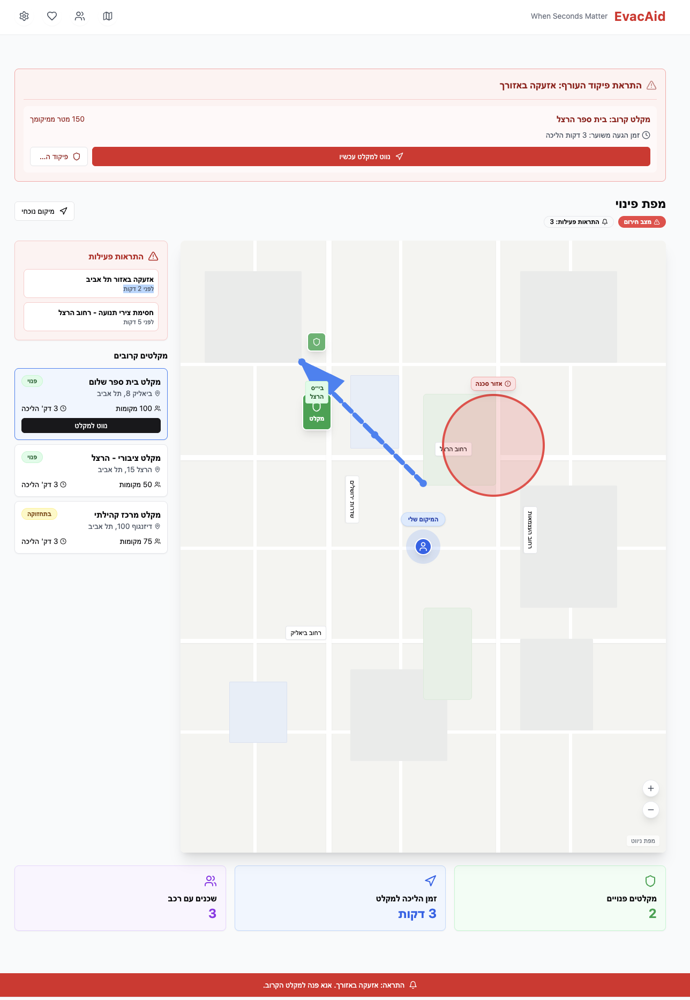
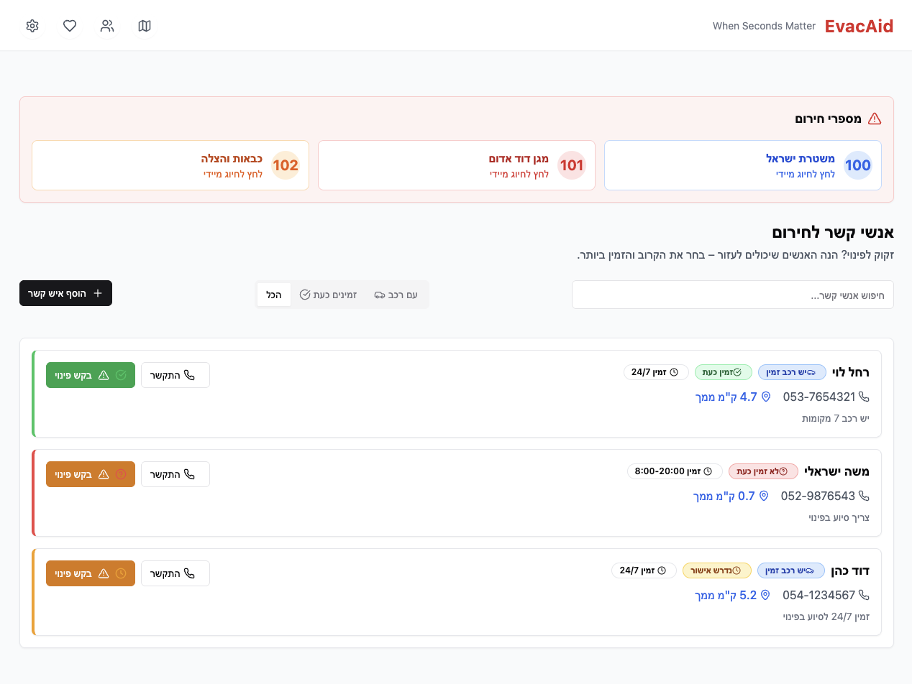
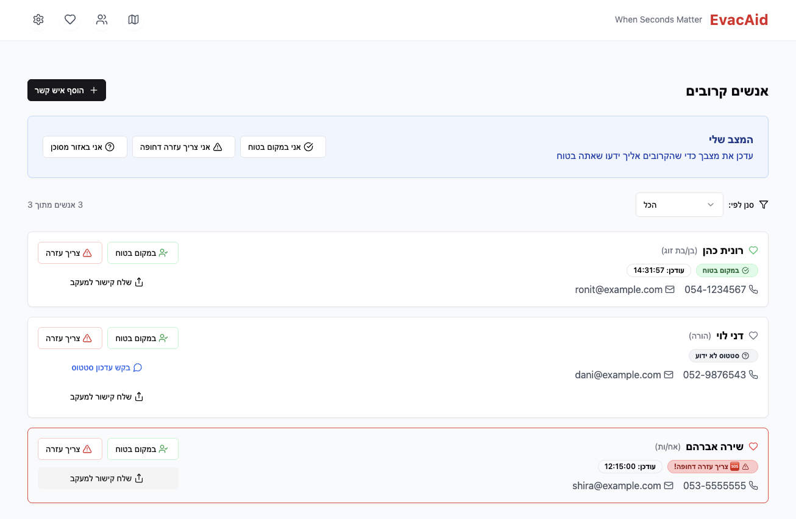
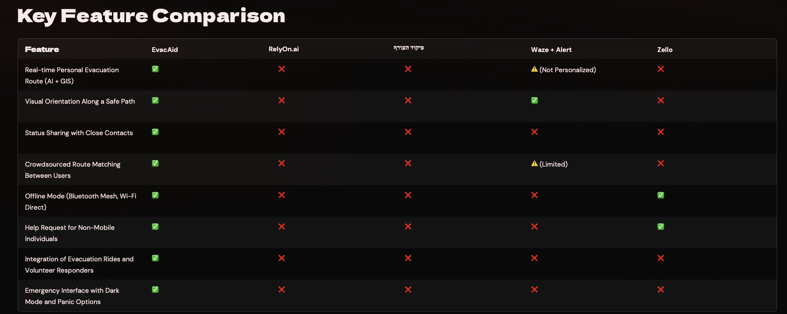

# EvacAid: when seconds matter

A hackathon prototype of an emergency app that guides civilians to the nearest shelter and helps them coordinate with the people around them.

**Finalist, Ariel University × Amazon hackathon** on startup solutions for recovery, resilience and emergency response · team of five · prototype built with [Base44](https://base44.com)

**Live prototype:** [open in Base44](https://app.base44.com/apps/680e0a913bf6568230dcb0c9)

## The problem

In a missile attack, wildfire or earthquake, civilians get a general alert and then have to work out on their own where to go and how fast. The result is confusion, delayed reactions and traffic jams, at the moment when every second counts. People without a car, the elderly and families with young children are hit hardest. The team drew on real events: October 7 in Israel, the California wildfires and the earthquakes in Turkey.

## The idea

One app that gives each person a personal answer to "where do I go, and who can help me get there":

| Screen | What it does |
|---|---|
| Evacuation map | Nearest shelters with capacity and status, walking time, a suggested route and nearby danger zones |
| Emergency contacts | Trusted people nearby, who has a car and who is available now, with one-tap call or evacuation request |
| Close people | Share your status (safe, need help, in a danger zone) and see the status of family members |
| Guidance and settings | Quick emergency instructions, offline maps, an evacuation drill and links to official Home Front Command guidance |

| Emergency contacts | Close people |
|---|---|
|  |  |

## Who it serves

The direct users are civilians in conflict and disaster zones, especially people who need help to evacuate. Municipalities and emergency teams could use it to see who needs assistance. We also proposed a less obvious partner: life insurers, since faster and safer evacuation lowers the risk they carry.

We compared EvacAid with the tools people use today, such as Waze, the Home Front Command app and walkie-talkie apps. Each covers part of the need; none combines personal routing, status sharing and ride coordination.

## What is real and what is not

This is a hackathon prototype, not a working product. The screens are interactive, but shelters, routes, alerts and contacts are sample data, and the route is drawn rather than calculated. [evacaid_api_example.py](evacaid_api_example.py) shows the app's data model (contacts, shelters, emergency settings and family members) through the Base44 entity API.

Turning it into a real product would start with data: official shelter locations from municipal open data, the protection time for each area, and real walking routes. That alone answers a useful question, even without an app: which neighbourhoods are too far from a shelter to reach it in time.

## Team

Nir Avrahamoff, Tomer Meirovich, Nadav Schclar, Tomer Baruch and Eyal Haim Buzaglo.

The project reached the hackathon finals. My part: I built the prototype in Base44 and presented the project to the judges in the final.
